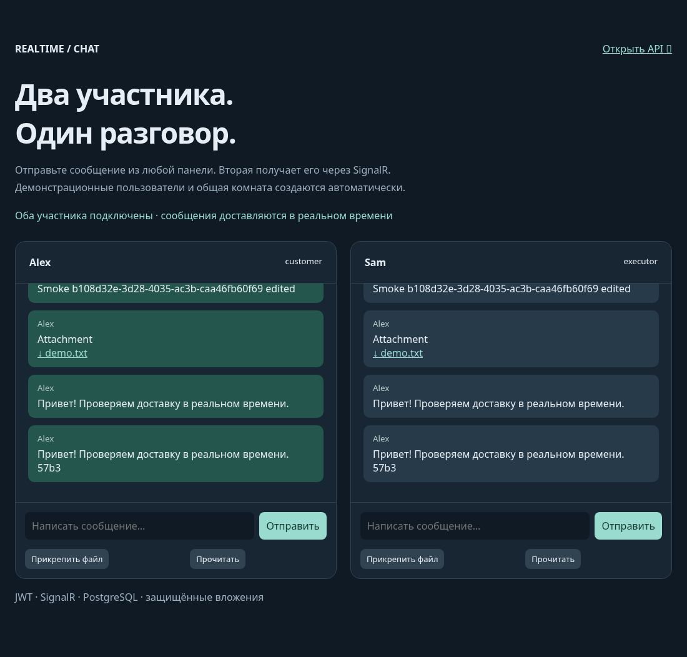
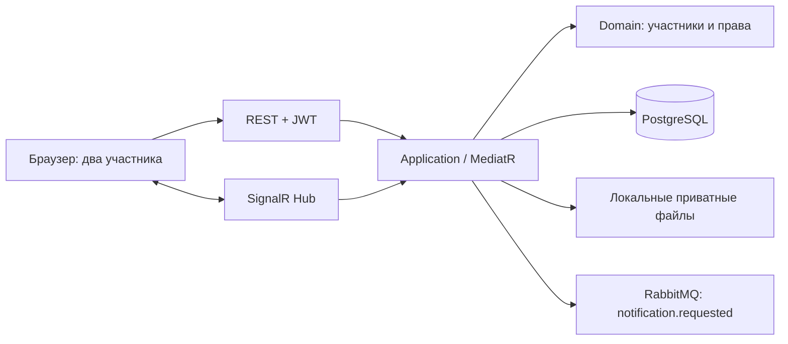
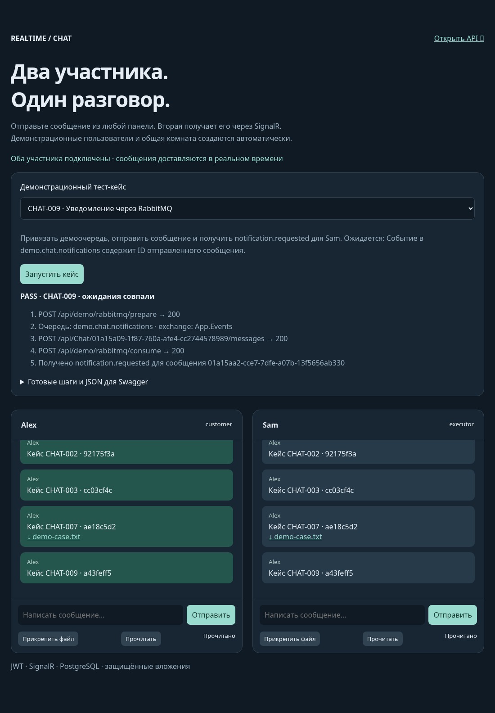

# Realtime Chat Service



Самостоятельный сервис чатов на ASP.NET Core и SignalR. Сохраняет сообщения в PostgreSQL, поддерживает историю, поиск, редактирование, прочтение, индикатор набора, присутствие, управление участниками и вложения.

Портфолио-адаптация сервиса, который автор разрабатывал в рабочем проекте. Корпоративная авторизация заменена локальной JWT-конфигурацией, добавлены автономное хранилище файлов, синтетические пользователи и демонстрационная страница.

**Стек:** .NET 10, ASP.NET Core, SignalR, JWT Bearer, PostgreSQL, EF Core, MediatR, AutoMapper, RabbitMQ, xUnit, Docker Compose.

## Запуск

Нужен Docker с Compose v2:

```sh
cp .env.example .env
docker compose up --build -d
```

Откройте **http://localhost:8030**. На странице находятся два участника общей комнаты — Alex и Sam. Каждая панель имеет собственный JWT и WebSocket-соединение. Отправьте сообщение, отметьте прочтение или прикрепите файл. История сохраняется при обновлении страницы и перезапуске контейнеров.

Swagger: http://localhost:8030/swagger. SignalR hub: `/chatHub` или `/api/chat/hub`. Проверка зависимостей: `/health`.

Compose включает `Development`: создание демонстрационной комнаты и выдача токенов через `/api/dev/token` доступны только в этом окружении. Порты опубликованы на loopback. В production эти endpoints возвращают `404`; настройте собственную выдачу JWT и ключи, прежде чем открывать сервис в сеть. Демонстрационная страница предполагает development endpoints.

## Архитектура



- **Domain:** разговоры, сообщения, участники, роли, статусы и правила доступа.
- **Application:** команды и запросы, сохранение через unit of work, история изменений и уведомления.
- **Infrastructure:** EF Core, PostgreSQL, репозитории, публикация запроса уведомления.
- **API:** REST, SignalR, JWT, демосценарий и защищённая загрузка файлов.

Идентичность участника включает tenant, ID пользователя и тип участника. Проверки доступа выполняются на сервере и для REST, и для hub. Присутствие распространяется внутри tenant. Группы переписки доступны участникам разговора.

## Вложения

Файлы хранятся вне `wwwroot` в отдельном Docker volume. До прикрепления файл доступен владельцу загрузки. После прикрепления его могут скачать действующие участники соответствующего разговора. Посторонний пользователь и пользователь другого tenant получают `403`.

Клиент передаёт ID файла, но имя, размер и URL вложения сервис берёт из собственной записи. Произвольный URL клиента не сохраняется как доверенная ссылка. Загрузка ограничена 50 МБ. Скачивание требует JWT и возвращает файл как attachment; ссылка сама по себе не даёт доступа.

## Примеры API

Создание демокомнаты:

```sh
curl -X POST http://localhost:8030/api/demo/bootstrap
```

Получение development-токена:

```sh
curl http://localhost:8030/api/dev/token \
  -H 'Content-Type: application/json' \
  -d '{"userId":1,"role":"customer","tenantId":"demo"}'
```

Дальнейшие запросы используют заголовок `Authorization: Bearer <token>`:

| Запрос | Действие |
| --- | --- |
| `GET /api/Chat` | Список разговоров текущего участника |
| `GET /api/Chat/{id}/messages` | История |
| `POST /api/Chat/{id}/messages` | Отправка: `{"text":"Привет"}` |
| `PUT /api/Chat/{id}/messages/{messageId}` | Редактирование |
| `POST /api/Chat/{id}/read` | Прочтение |
| `GET /api/Chat/{id}/messages/search?q=...` | Поиск |
| `POST /api/Chat/upload` | Загрузка multipart-поля `file` |
| `GET /api/files/{fileId}/download` | Защищённое скачивание |

События SignalR включают `MessageReceived`, `MessageEdited`, `MessageDeleted`, `MessageRead`, `PresenceChanged`, `UserTyping` и `UserStoppedTyping`. После подключения клиент вызывает `JoinConversation` с ID разговора. Development-страница использует встроенный JSON-протокол SignalR через WebSocket, без внешнего CDN.

## Демонстрационные тест-кейсы

На главной странице доступны **9 выбираемых кейсов**: доставка, редактирование, прочтение, JWT, посторонний пользователь, другой tenant, вложения, закрепление и уведомление RabbitMQ. Страница выполняет реальные запросы и показывает PASS/FAIL с журналом шагов.

В Swagger есть **Authorize**, примеры JWT для Alex/Sam/Visitor/OtherTenant и готовые тела сообщений. Подробные шаги: [TEST-CASES.ru.md](docs/TEST-CASES.ru.md). Наблюдение уведомлений через брокер: [RABBITMQ.ru.md](docs/RABBITMQ.ru.md). Management UI RabbitMQ доступен на http://localhost:15673.



## Проверки

Для модульных тестов нужен .NET 10 SDK:

```sh
dotnet test RealtimeChat.sln -c Release
```

Тесты репозиториев требуют отдельную тестовую PostgreSQL; без `CHAT_DB_TEST` они явно пропускаются:

```sh
CHAT_DB_TEST='Host=localhost;Database=chat_tests;Username=demo;Password=your-test-password' \
  dotnet test RealtimeChat.sln -c Release
```

После запуска Compose выполните проверку реальных WebSocket-соединений и вложений; нужен Node.js 22+ без npm-зависимостей:

```sh
node scripts/smoke.mjs
```

Проверяются JWT, граница tenant, запрет доступа посторонним, доставка двум клиентам, прочтение, набор текста, редактирование, поиск и приватность файлов. GitHub Actions поднимает тестовую PostgreSQL для тестов репозиториев и выполняет этот сквозной сценарий.

## Ограничения

Присутствие и индикатор набора рассчитаны на один экземпляр приложения. Для нескольких экземпляров нужен общий механизм координации и SignalR backplane. Вложения используют локальный volume; интерфейс `IFileStorageService` позволяет подключить объектное хранилище.

Сохранение сообщений является долговечным. Публикация внешних запросов уведомлений в RabbitMQ — best effort и не входит в одну транзакцию с сообщением. Для гарантированной доставки внешних уведомлений потребуется outbox; проект не заявляет такую гарантию.

Обновления SignalR не являются журналом доставки: после переподключения клиент должен прочитать историю через REST. RabbitMQ используется для границы внешних уведомлений; сервис отправки email/push не входит в Compose.

AutoMapper 16 используется в режиме разработки/демонстрации. Для коммерческого production-применения нужно учитывать условия лицензирования этой зависимости.

Dockerfile публикует self-contained приложение Linux x64 из закреплённого официального SDK. Контейнер запускается без root. Подробнее о границах портфолио и формулировках для резюме — в [RESUME.ru.md](docs/RESUME.ru.md).
